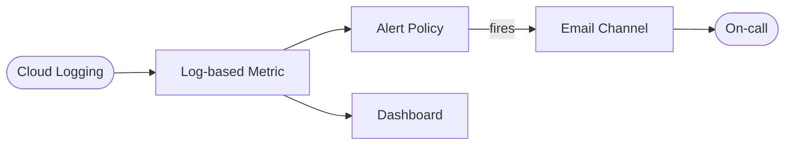

# GCP Cloud Observability Stack (Terraform)

> Monitoring on Google Cloud: a log-based metric, an alert policy, an email notification channel, and a dashboard — provisioned with Terraform.
> **Author:** Muhammad Ahmad · **IaC:** Terraform · **Cloud:** GCP


---

## 📌 Overview

- A **log-based metric** counts log entries at severity `ERROR` or higher.
- An **alert policy** fires when the error count goes above zero.
- A **notification channel** emails the on-call address when the alert fires.
- A **dashboard** charts the error-count metric over time.

A reusable monitoring baseline you can point at any workload's logs.

## 🏗️ Architecture

> 🎨 **Interactive diagram (industry-standard icons):** [open in Lucid — page 30](https://lucid.app/lucidchart/3da75ce3-ea66-4296-81b3-00d20a60435b/edit)



## 🚀 Deploy

```bash
cd terraform
gcloud auth application-default login
terraform init
terraform apply -var="project_id=YOUR_PROJECT_ID" -var="alert_email=you@example.com"
```

## 🧹 Clean up

```bash
terraform destroy -var="project_id=YOUR_PROJECT_ID"
```

## 💰 Cost note

Log-based metrics, alerts, and dashboards are effectively free for typical volumes; you pay for log ingestion/retention.

## 🔐 Production hardening (next steps)

- Add **uptime checks** and latency/availability SLOs.
- Route critical alerts to **PagerDuty / Slack** channels.
- Add **log sinks** to BigQuery for long-term analysis.

---

*Built and maintained by **Muhammad Ahmad**.*
