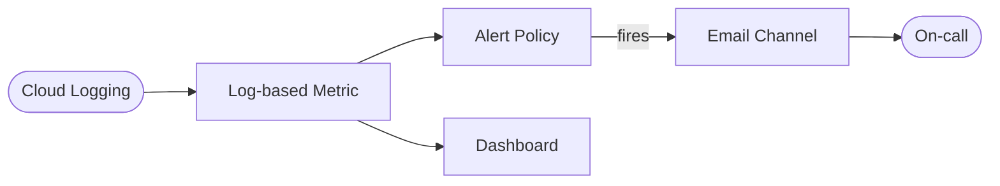

# Architecture Diagram — GCP Cloud Observability Stack

## Lucid diagram

- **Master Lucid document (all 30 diagrams, icon style):** https://lucid.app/lucidchart/3da75ce3-ea66-4296-81b3-00d20a60435b/edit
- This project is **page 30** of that document.

## Lucid prompt (reusable)

```
Create a GCP monitoring diagram titled "GCP Cloud Observability Stack".
Cloud Logging feeds a Log-based Metric; the metric drives both an Alert Policy and a
Dashboard. When the Alert Policy fires it notifies an Email Channel which reaches the
on-call person. Label the arrows. Clean, professional Google Cloud colors.
```

## Mermaid source


